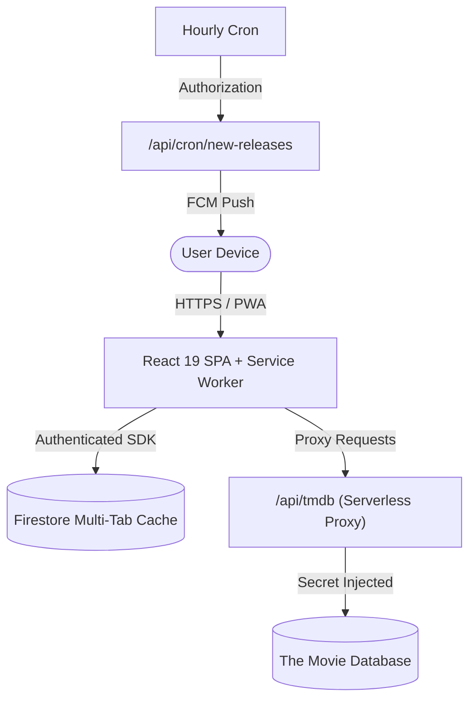

# CineTrack v2

> **Track. Rate. Remember.** A fast, installable, offline-capable personal movie and TV tracking Progressive Web App.

[](https://www.typescriptlang.org/)
[](https://react.dev/)
[](https://vitejs.dev/)
[](https://web.dev/progressive-web-apps/)
[](https://opensource.org/licenses/MIT)

---

## Overview

CineTrack v2 is built from the ground up to provide movie and television enthusiasts with a unified place to log what they watch, track TV shows episode by episode, organize custom collections, plan watches on a calendar, analyze viewing habits, and receive daily release digests.

### Key Features

- **Multi-Tenant Architecture**: Strict user isolation via Firebase Security Rules (`request.auth.uid == userId`). No hardcoded accounts.
- **Zero-Secret Client Bundle**: All TMDB metadata queries route through a serverless proxy (`/api/tmdb`) with route allow-listing and server-side token injection.
- **Atomic Multi-Document Operations**: Transactional writes (`writeBatch`, `runTransaction`) ensure history logging, status updates, and summary counters never drift.
- **TV Episode Progression**: Track shows episode-by-episode with season maps, collapsible overviews, "mark all up to here", and confetti show-completion celebrations.
- **Calendar & Planning**: Month and agenda views combining scheduled watches and upcoming episode air dates.
- **Rich Interactive Analytics**: Recharts visualizations for watch time, top genres, rating distribution, release decades, 16-week activity heatmap, and annual "Year in Review" highlights—all with accessible HTML table alternatives.
- **PWA & Offline Resilience**: Powered by `vite-plugin-pwa` and Workbox with `CacheFirst` strategies for posters and multi-tab IndexedDB cache for offline library and history browsing.
- **Data Tools**: Full JSON backup export, Letterboxd CSV import wizard (`watched.csv`, `ratings.csv`), and counter repair engine (`recomputeStats`).

---

## Architecture



---

## Getting Started

### Prerequisites
- Node.js 20+
- npm 10+
- A Firebase project (or the Firebase Local Emulator Suite)
- A TMDB API Read Access Token

### Installation

1. Clone the repository:
   ```bash
   git clone https://github.com/your-username/cinetrack-v2.git
   cd cinetrack-v2
   ```

2. Install dependencies:
   ```bash
   npm install
   ```

3. Configure environment variables:
   Copy `.env.example` to `.env`:
   ```bash
   cp .env.example .env
   ```
   Fill in your Firebase credentials:
   ```env
   VITE_FIREBASE_API_KEY=your_api_key
   VITE_FIREBASE_AUTH_DOMAIN=your_project.firebaseapp.com
   VITE_FIREBASE_PROJECT_ID=your_project_id
   VITE_FIREBASE_STORAGE_BUCKET=your_project.appspot.com
   VITE_FIREBASE_MESSAGING_SENDER_ID=your_sender_id
   VITE_FIREBASE_APP_ID=your_app_id
   TMDB_READ_TOKEN=your_server_only_tmdb_token
      ```

4. Start development server:
   ```bash
   npm run dev
   ```

---

## Available Scripts

| Script | Command | Description |
| :--- | :--- | :--- |
| `dev` | `npm run dev` | Starts Vite dev server with hot module replacement |
| `build` | `npm run build` | Compiles TypeScript and builds production PWA bundle |
| `typecheck` | `npm run typecheck` | Validates strict TypeScript compilation (`tsc -b --noEmit`) |
| `lint` | `npm run lint` | Runs Oxlint across all TypeScript and CSS files |
| `test` | `npm run test` | Runs unit tests via Vitest |

---

## Attribution & Data Sources

This product uses the TMDB API but is not endorsed or certified by TMDB.

All movie and TV metadata, posters, cast information, and watch provider links are provided by [The Movie Database (TMDB)](https://www.themoviedb.org/).

---

## License

MIT License. See [LICENSE](LICENSE) for details.
