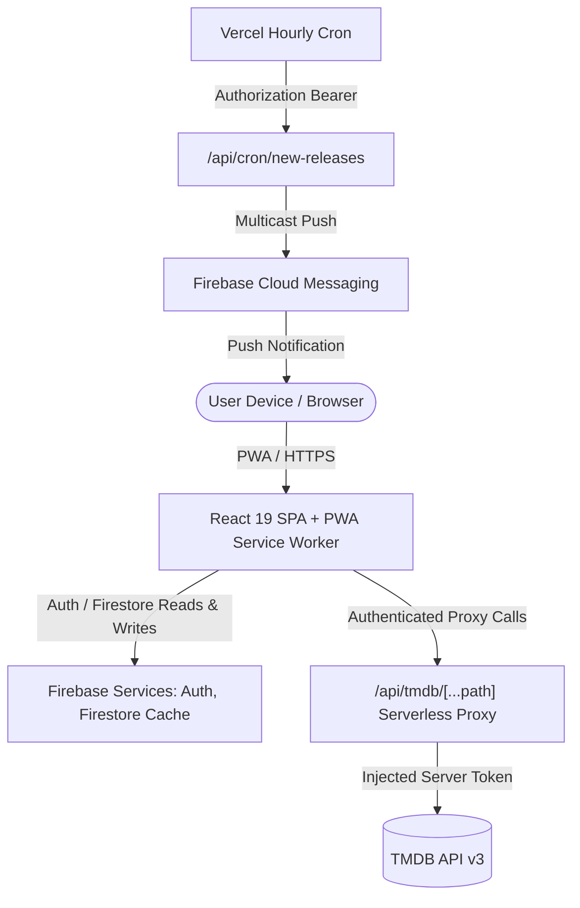

# CineTrack v2: Architecture Overview

CineTrack v2 is a modern, high-performance, installable Progressive Web App (PWA) built for movie and television tracking, episode logging, and viewing analytics.

---

## 1. Core Principles

- **Zero Secrets in Client Bundle**: All third-party upstream API tokens (TMDB Read Access Token, Firebase Service Account keys, Cron secret) live strictly on the server side (`/api/tmdb`, `/api/cron`).
- **Multi-User Isolation**: Every Firestore read and write is authenticated and strictly scoped to `request.auth.uid == userId`. No single-user hardcoded emails.
- **Offline-First Persistence**: Leverages Firestore multi-tab IndexedDB cache (`persistentMultipleTabManager`) rather than custom flaky offline queues. Writes made offline are safely queued and committed when online.
- **Atomic Multi-Document Writes**: Status updates, episode logging, and library removals use transactional batches (`writeBatch` / `runTransaction`) to prevent counter drift.
- **Strict File Budgeting**: Every source file is kept strictly under 300 lines of code.

---

## 2. Technical Stack

| Layer | Technology | Rationale |
| :--- | :--- | :--- |
| **UI Framework** | React 19 + TypeScript | Strict typing (`noUncheckedIndexedAccess`, `exactOptionalPropertyTypes`). |
| **Build & Tooling** | Vite 8 + Oxlint + Vitest | Lightning-fast HMR, sub-second linting, and comprehensive unit tests. |
| **Server State** | TanStack Query v5 | Scoped caching, background invalidation, and request deduplication. |
| **Client UI State** | Zustand 5 | Ephemeral UI state (sidebar collapse, search filters, toast notifications). |
| **Database & Auth** | Firebase 13 (Auth + Firestore) | Multi-provider authentication (Google, Email/Password), persistent multi-tab offline cache. |
| **PWA & Offline** | vite-plugin-pwa + Workbox | Standalone display mode, runtime caching for TMDB images and API responses, background sync. |
| **Styling & Tokens** | CSS Modules + Vanilla CSS | Zero runtime overhead design token system (`tokens.css`) supporting Dark and Light themes. |
| **Charts & Dataviz** | Recharts 3.x | Accessible data visualizations with hidden accessible `<table>` alternatives for screen readers. |

---

## 3. Serverless API Architecture

### TMDB Proxy (`/api/tmdb/[...path].ts`)
- Enforces route allow-listing (`search/*`, `trending/*`, `discover/*`, `movie/*`, `tv/*`).
- Injects `TMDB_READ_TOKEN` server-side so it is never exposed in client bundles.
- Emits HTTP caching headers (`s-maxage=3600, stale-while-revalidate=86400`) to accelerate responses.

### Release Notification Cron (`/api/cron/new-releases.ts`)
- Scheduled hourly in `vercel.json` (`0 * * * *`).
- Authenticated via `Authorization: Bearer ${CRON_SECRET}`.
- Per-user timezone calculation matches the user's preferred local digest hour (`digestHourLocal`) and skips users already notified today.
- Supports `?dryRun=1` mode.
